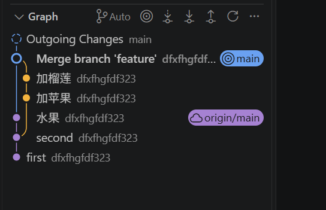

# 任务一 · Git 学习记录

## 分支与合并

下图记录了一次在 `main` 上完成分支合并、并推送同步到远端的过程：



图中可以看到：

- `first`、`second` 是最早的两次提交（紫色圆点，表示已在远端）
- `水果`、`加苹果`、`加榴莲` 是在 `feature` 分支上依次新增的三次提交（黄色圆点）
- 顶部的 `Merge branch 'feature'` 是把 `feature` 合并回 `main` 的结果
- 右侧标签显示：`origin/main` 指向合并前的提交，`main` 指向最新的合并提交，因此 `main` 领先远端若干提交，需要执行 `git push` 才能同步

## 常用命令

```bash
git switch -c feature      # 新建并切换到 feature 分支
git add .                  # 暂存修改
git commit -m "说明"        # 提交
git switch main            # 切回主分支
git merge feature          # 把 feature 合并进 main
git push                   # 推送到远端
```
